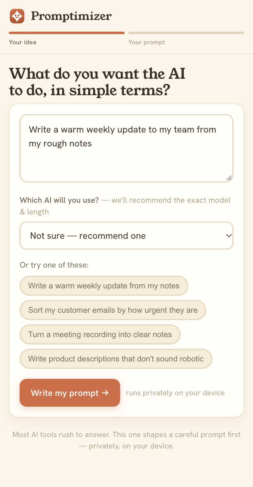
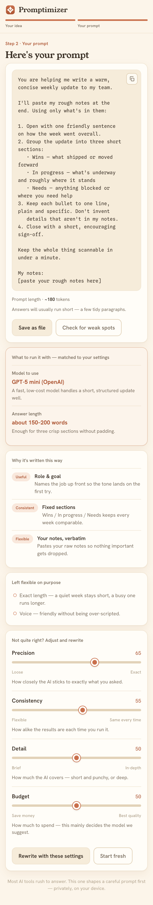
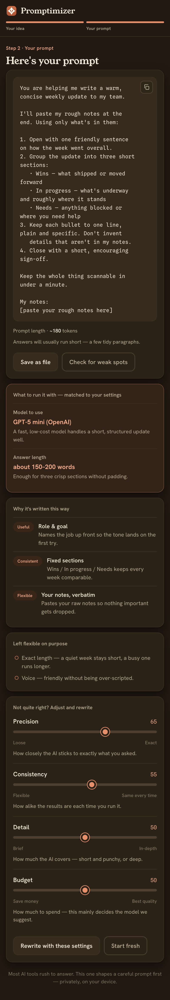

  
  <h1>Promptimizer</h1>
  
<strong>Turn a rough idea into a precisely engineered, ready-to-paste AI prompt — generated privately on your device.</strong>

  
No API key. No account. No servers. Nothing you type ever leaves your browser.

Promptimizer is a Chrome extension. Describe what you want in plain words; it
writes a polished prompt, tells you which model and answer length to run it with,
lets you fine-tune and rewrite, and can check the prompt for weak spots. It runs
entirely on-device using Chrome's built-in AI (Gemini Nano).

## Screenshots

| 1 · Describe your idea | 2 · Get an engineered prompt |
| :---: | :---: |
|  |  |

  
<strong>Dark mode</strong>

   
  

## Why it's different

- **Private by design.** Inference runs on-device with Chrome's built-in Prompt
  API (Gemini Nano). No key, no network call, no cost — it even works offline.
- **One step.** Say what you want; get a prompt. No forms, no interrogation.
- **It tunes, not just generates.** Four levers — Precision, Consistency, Detail,
  Budget — reshape the prompt and drive a concrete model + answer-length
  recommendation. Rewrite as many times as you like.
- **It checks its own work.** A weak-spot pass flags where a prompt could drift
  or come out inconsistent, with specific fixes you can apply.

## Requirements

A recent version of Chrome with built-in AI available on the device. If it's
gated behind a flag, enable `chrome://flags/#prompt-api-for-gemini-nano` and
restart Chrome. The first run downloads the model once; after that it's instant.
If the model isn't available, the extension says so instead of failing mid-flow.

## Install (from source)

1. Clone or download this repository.
2. Open `chrome://extensions`.
3. Turn on **Developer mode** (top-right).
4. Click **Load unpacked** and select this folder (the one with `manifest.json`).
5. Click the Promptimizer icon and start.

## How it works

The whole flow lives in the toolbar popup. `popup.js` calls Chrome's
`LanguageModel` API directly — each step sends one small instruction and gets
back one JSON object, so the model's short context window is a non-issue. Your
settings and in-progress state are saved to `chrome.storage.local` so the popup
resumes where you left off. There is no background server and no host
permission.

## Privacy

Promptimizer collects nothing and transmits nothing. Full details in
[PRIVACY.md](PRIVACY.md).

## Note on the model recommendation

The "Model to use" suggestion on the result screen is about where *you'll run the
finished prompt* (ChatGPT / Claude / Gemini, per your choice) — it's advice, not
something the extension calls.
